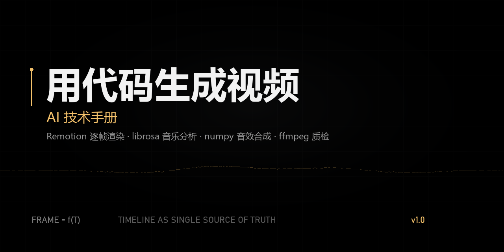

# 用代码生成视频 · AI 技术手册

**A practical handbook for generating videos with code — written for AI agents.**

[](./LICENSE)
[](https://creativecommons.org/licenses/by/4.0/)
[](https://www.remotion.dev/)
[](https://nodejs.org/)
[](./HANDBOOK.md)



---

## 这是什么

一份**可以直接交给 AI 执行**的短视频生产手册，配一套可复用的工程模板。

它不讨论“AI 视频生成模型”，讲的是另一条路——**用代码把每一帧画出来**：

- 画面：Remotion（React 逐帧渲染），每一帧都是 `frame` 的纯函数
- 音乐：librosa 实测 BPM、重拍、换气点，不靠耳朵猜
- 音效：numpy 合成，音高取自配乐调性，瞬态对齐到采样
- 质检：ffmpeg 解码 + 互相关测音画偏移，0 ms 才算过

所有数字、时间点、参数都是两个真实项目里实测出来的，不是推测。

---

## 为什么值得看

大多数“AI 做视频”的教程停在这一步：给你一段提示词，生成一堆不可控的片段。

这份手册解决的是**可控性**：

| 痛点 | 手册里的解法 |
|---|---|
| 音画对不齐 | 画面/音效/字幕共用一条 `timeline.json`，单位是帧 |
| 卡点靠感觉 | 逐帧响度表 + 起音强度，自己测出换气点和重拍帧 |
| 音效找不到素材 | 11 种音色全部用 numpy 合成，无版权问题 |
| 动效不成体系 | 爆点、转场、推镜头、漏斗图等 10 套现成模式 |
| 渲染质量差 | CRF / PNG 帧 / 2K 放大 / 交付前自检流程 |

---

## 内容地图

| 章节 | 你会拿到 |
|---|---|
| 0. 工作守则 | 先出 10–20 秒试片、长任务定时汇报、数字必须可算 |
| 1–2. 技术栈与环境 | 无管理员权限从零装通(Node / ffmpeg / Chrome / Python) |
| 3. 项目结构 | 可直接复制的目录模板 |
| 4. Remotion 规范 | 纯函数帧、`interpolate` 必带 clamp、字体加载、逻辑尺寸缩放 |
| 5. 时间轴 | `timeline.json` 结构与“同一公式写两遍”的同步技巧 |
| 6. 音乐分析 | 逐帧响度表怎么读，重拍是“起音帧”不是“最响帧” |
| 7. 音效合成 | 11 个音色的完整实现 + 配方表（什么画面配什么声音） |
| 8. 视觉动效 | 字幕、爆点、转场、推镜头、屏幕点按反馈 |
| 9. 内容方法论 | 60 秒骨架、锚词、结尾提问、2026 年的推荐机制 |
| 10. 渲染与质检 | 关键帧、CRF、2K/4K、互相关测同步 |
| 11. 复刻流程 | 接触表 → 运动曲线 → 取色测坐标 → 对比图 |
| 12. 常见坑 | 12 条踩过的坑与解法 |
| 13. 提示词模板 | 一版修正过错误的启动提示词 |
| 14. 文件索引 | 源码与工具的对应关系 |

---

## 快速开始

```bash
git clone https://github.com/<your-name>/code-video-handbook.git
cd code-video-handbook/vibe-video
npm install
npx remotion studio          # 打开可视化预览
```

渲染一条：

```bash
npx remotion render BinaryGuess out/demo.mp4 \
  --browser-executable="/path/to/chrome" \
  --crf=16 --image-format=png
```

> Windows 用户：记得加 `--bundle-cache=false`，并先删掉 `node_modules/.cache`。
> 具体原因见手册 §12。

**先做冒烟测试**：渲染 `SmokeTest` 的第 30 帧，出图正常再往下走。

```bash
npx remotion still SmokeTest out/ready.png --frame=30
```

---

## 仓库结构

```
.
├─ HANDBOOK.md              # 正文(15 节)
├─ README.md
├─ LICENSE                  # 代码 MIT
├─ .gitignore
├─ assets/
│  └─ social-preview.png
└─ vibe-video/              # 可运行模板
   ├─ package.json          # Remotion 4.0.536 / React 19
   ├─ src/
   │  ├─ Root.tsx           # Composition 注册
   │  ├─ timeline.json      # 时间轴(帧 @30fps)
   │  ├─ binary/            # 示例一：纯黑科普风
   │  └─ wenku/             # 示例二：纸面风 App 介绍片
   ├─ tools/                # 10 个 Python 工具
   └─ public/               # 字体/配乐/素材(需自行放入)
```

---

## 工具清单

| 脚本 | 作用 |
|---|---|
| `analyze_beats.py` | BPM、节拍、强弱拍 → JSON |
| `find_drop.py` | 自动找“换气 + 重拍”候选并打分，输出结构分段 |
| `precise_15_19.py` | 任意时段的逐帧响度 / 起音表（最常用） |
| `prep_binary.py` | 调性估计 + 算法步数计算示例 |
| `sfx.py` | 音效合成器：读 timeline → 输出整条 `sfx.wav` |
| `check_sync.py` | 成片音画偏移（互相关） |
| `analyze_ref_audio.py` | 参考视频的响度轮廓、强起音、近静音段 |
| `motion_curve.py` | 参考视频逐帧运动曲线，找出动作起止帧 |
| `compare_sheet.py` | 原片 / 复刻版对比图 |
| `make_qr.py` | 矢量二维码（任何分辨率都清晰） |
| `stills.cjs` | 一次打包、多帧抽图（绕开反复启动 CLI 的卡顿） |

---

## 两条实测结论

**1. 爆点对准“起音帧”，不是“最响帧”。**

以常用配乐为例：重拍在 16.30 s（第 489 帧），onset 强度 12.44；响度峰值却出现在 16.37–16.40 s。
画面动作若对准峰值，观感会“慢半拍”。正确做法是提前 3–4 帧起手，让冲击落在 16.30 s。

**2. 音效音量不能直接叠加。**

配乐自身峰值可能超过 1.0。配乐 0.85 + 音效轨 1.0 实测混音峰值 1.378，必然削波。
发布前用 numpy 算一次真实峰值：

```python
peak = np.abs(sfx * g_sfx + bgm * g_bgm).max()   # 目标 ≤ 0.95
```

---

## 适合谁

- 想用代码稳定产出竖屏/横屏知识类短视频的开发者
- 需要批量、可复现、可版本管理的视频流水线
- 正在给 AI agent 搭“视频生产”工具链的人

**不适合**：想用生成模型做写实画面、口播数字人、长视频剪辑的人。

---

## 素材与版权

本仓库**只包含代码和文档**，不附带任何第三方音频、字体、截图或成片。

- `public/` 目录需要你自己放入字体与配乐
- 手册中提到的曲目仅用于说明测量方法，**不提供音频文件**
- 示例代码中的界面风格仅作技术演示，不代表任何真实产品
- 商用前请确认：配乐授权、字体授权、以及 Remotion 的商业许可（团队 > 3 人需购买）

---

## 许可证

- **代码**（`vibe-video/`、`tools/`）：[MIT](./LICENSE)
- **文档**（`HANDBOOK.md`、`README.md`）：[CC BY 4.0](https://creativecommons.org/licenses/by/4.0/) — 署名后自由转载、改编、商用

---

## 贡献

勘误、新的动效模式、别的配乐实测数据都欢迎。提 PR 前请读 [CONTRIBUTING.md](./CONTRIBUTING.md)。

如果这份手册帮你省下了一个通宵，点个 ⭐ 就够了。
